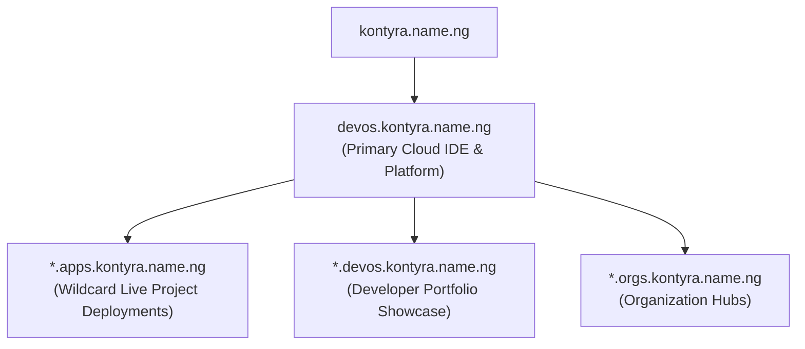

# DevOS Product Design & Architecture Standard

> **Official Kontyra Brand Specification & Product Division Guidelines**  
> Division: **Developer Cloud Execution Platforms & Cloud IDEs**  
> Canonical URL: `devos.kontyra.name.ng`  
> Wildcard Apps Domain: `*.apps.kontyra.name.ng`  
> Developer Portfolios: `*.devos.kontyra.name.ng`  
> Brand Accent: **Electric Blue (`#079BFF` / `#3B82F6`)**  
> Aesthetics: **Pure Black Apple Minimalist Architecture**

---

## 1. Product Mission & Vision

DevOS is the flagship developer execution platform and cloud IDE within the Kontyra ecosystem. It delivers instantaneous browser-based development environments, live code execution containers, automated Edge deployments, and Git integration without local friction or resource exhaustion.

---

## 2. Core Aesthetic Philosophy: Apple Pure Black Minimalism

DevOS adheres strictly to a pure black, high-precision aesthetic inspired by Apple's dark interfaces:

| Surface Layer | Hex / Tailwind Token | Purpose |
|---|---|---|
| **Root Canvas** | `#000000` / `bg-[#000000]` | Absolute black backdrop across all editor and workspace views. |
| **Surface Level 1** | `#0A0B10` / `bg-[#0a0b10]` | Sidebar navigation, file explorer panels, elevated toolbars. |
| **Surface Level 2** | `#12131A` / `bg-[#12131a]` | Modals, floating sheets, preview cards, command palettes. |
| **Glass Overlay** | `bg-white/[0.02]` to `bg-white/[0.04]` | Interactive list items, hover states, card backdrops with `backdrop-blur-xl`. |
| **Hairline Borders** | `border-white/[0.08]` (`1px solid rgba(255, 255, 255, 0.08)`) | Subtle, razor-sharp perimeter division between editor panes. |
| **Active Highlights** | `border-blue-500/40`, `bg-blue-600/10` | Selected files, active tabs, current git branch, focus states. |
| **Status Embellishments** | Green (`#10B981`), Amber (`#F59E0B`), Red (`#EF4444`) | Deployment status dots, dirty file indicators, error banners. |

---

## 3. Dedicated Workspace Deep-Linking & Routing Architecture

To guarantee state persistence and prevent users from losing their workspace context when hitting browser refresh, every project features a deterministic, permanent URL.

### A. Direct IDE URLs
- **Canonical Workspace Route:** `/project/:projectId/ide`
- **Supported Aliases:**
  - `/ide/:projectId`
  - `/project/:projectId/edit`
  - `/projects/:projectId`
- **Multi-Identifier Resolution:** The route gracefully resolves whether `:projectId` is:
  1. The direct Firestore Document ID (e.g. `2s6D819a...`)
  2. The unique 6-character `appId` (e.g. `lsho0i`)
  3. The URL-friendly `projectSlug` (e.g. `kontyra-docs`)

### B. Persistent Refresh Behavior
- When working in the IDE, the browser address bar strictly reflects `/project/:projectId/ide`.
- Pressing **Refresh (F5 / Ctrl+R)** reloads the exact workspace and open files directly—never falling back to `/projects` or `/`.
- The IDE header back button cleanly routes the developer back to `/projects`.
- Legacy query parameters (`/projects?open=:projectId`) automatically 301-rewrite in the client router to `/project/:projectId/ide`.

---

## 4. Subdomain & Deployment Routing Standard

DevOS implements a multi-tier wildcard DNS architecture under `kontyra.name.ng`:

### URL Patterns
1. **Live App Previews:** `https://<project-slug>-<appId>.apps.kontyra.name.ng`
   - Automatically extracted by the subdomain router into `{ kind: "app-project", projectSlug, appId }`.
   - Seamlessly redirects to the live edge Vercel build or natively renders HTML/CSS/JS.
2. **Developer Portfolio:** `https://<username>.devos.kontyra.name.ng`
   - Highlights the developer's verified Kontyra projects, deployed apps, and tech stack.
3. **Dedicated Project Preview:** `https://<username>.devos.kontyra.name.ng/project/<slug>`
4. **Organization Hub:** `https://<orgSlug>.orgs.kontyra.name.ng`

---

## 5. Isolated Cloud Deployment Pipeline

To prevent user code from interfering with platform services or other projects, DevOS enforces strict deployment isolation:

1. **Dedicated Vercel Project Names:**
   - Every deployed project receives an isolated Vercel project name: `devos-<cleanSlug>-<appId>`.
   - **Critical Rule:** Never inherit `process.env.VERCEL_PROJECT_NAME`, which points to the DevOS platform itself.
2. **Direct Production Edge Targeting:**
   - Deploys directly to `target: "production"` to generate live `.vercel.app` production domains with green status indicators.
3. **Telemetry & Log Streaming:**
   - Real-time build events stream via Socket.io to the browser console.
   - Build logs are permanently archived in the project's `deployments` collection to allow instant historical viewing and one-click rollback.
4. **Composite Index Immunity:**
   - Client deployment subscriptions query with single-field indexes and perform in-memory chronological sorting to eliminate missing composite index errors.

---

## 6. Git & GitHub Integration Standard

The integrated Git panel in the DevOS IDE provides a seamless workflow matching modern desktop tools:

- **Sidebar Navigation Tab:** Positioned in the left tool rail (`Git & GitHub` with the official GitHub mark).
- **Staging & Commit Studio:** Inline diff viewing, commit message authoring with character counter, and commit history log.
- **Branch Management:** Active branch indicator, branch creation, and branch switching.
- **Pull Sync Architecture:** Resilient GitHub pull utilizing Firestore `batch.set(..., { merge: true })` to prevent `5 NOT_FOUND` missing document errors.
- **Repository Linking:** Clear repository badges (e.g. `RayRen445/kontyra-docs`) with direct links to GitHub.

---

## 7. Workspace Anatomy Specifications

- **Top Bar (56px):**
  - Left: Kontyra/DevOS monogram mark, project title, visibility badge (`[Public]` / `[Private]`), and back arrow.
  - Center: Command Palette search trigger (`Cmd + K` / `Ctrl + K`).
  - Right: Active Git branch indicator, Tour button, Share button, Fork button, and primary **Deploy** action button (`bg-blue-600 hover:bg-blue-500 rounded-xl`).
- **Left Tool Rail:**
  - Icons: Project Files (`FolderCode`), Deployments (`Rocket`), Git (`Github`), Analytics (`BarChart3`), Logs (`Terminal`), Variables (`Sliders`), Settings (`Settings`).
- **Editor Canvas:**
  - Multi-tab file bar with close buttons, modified indicator dot, and Monaco syntax highlighting.
- **Bottom Status Bar:**
  - Active GitHub repository link, sync button, build status indicator, branch name, and line/column metrics.
- **Bottom Drawer:**
  - Resizable terminal tabs: `bash`, `Build`, `Deploy`, `Events`.
