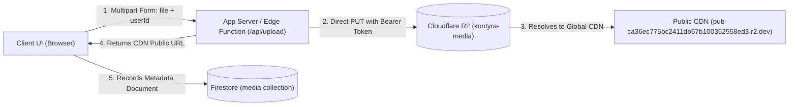

# 07 - Cloudflare R2 Media Storage & CDN Architecture

> **Target Audience:** All AI Coding Agents, Human Pair Programmers, and Full-Stack Developers working on any Kontyra application.  
> **Infrastructure Status:** **LIVE & TESTED** (Direct PUT upload & Public CDN delivery verified).  
> **Source of Truth:** `https://github.com/RayBen445/Kontyra-brand`

---

## 1. Overview & Architecture

All user-generated media, author avatars, book covers, event banners, and asset uploads across the Kontyra ecosystem are stored in **Cloudflare R2** and delivered globally via Cloudflare's edge CDN.



---

## 2. Shared Infrastructure Credentials

The centralized Cloudflare R2 bucket is shared across the entire Kontyra network:

| Property | Value | Notes |
| :--- | :--- | :--- |
| **Account ID** | `84bfebd0dbc3becf3f631b4b1a6720ef` | Cloudflare apex account |
| **API Bearer Token** | `process.env.R2_API_TOKEN` / `cfut_***` | Scoped for R2 object write & read (obtain from internal env) |
| **Bucket Name** | `kontyra-media` | Primary asset store |
| **Public CDN URL** | `https://pub-ca36ec775bc2411db57b100352558ed3.r2.dev` | Global edge distribution domain |
| **REST API Base** | `https://api.cloudflare.com/client/v4/accounts/84bfebd0dbc3becf3f631b4b1a6720ef/r2/buckets/kontyra-media/objects` | Target for direct PUT requests |

---

## 3. MANDATORY: App Folder & Partitioning Requirement

> [!IMPORTANT]
> **EVERY CODING AGENT MUST SET UP A DEDICATED FOLDER FOR THEIR APP.**
> Because all applications share the `kontyra-media` bucket, **never upload directly to the root of the bucket**.
> You MUST partition all object keys under your application's designated root folder:

### Canonical Object Key Structure:
```text
images/<app-slug>/<resource-type>/<userId-or-entityId>/<uuid>.<ext>
```

### Approved App Folder Directory:

| Application | Dedicated S3/R2 Folder Prefix | Example Object Key |
| :--- | :--- | :--- |
| **Novelora Studio** | `images/novelora/` | `images/novelora/covers/author_123/90ca2e1c.webp` |
| **REASTUDIA** | `images/reastudia/` | `images/reastudia/covers/novel-shadows/90ca2e1c.webp` |
| **Kontyra Accounts / SSO** | `images/accounts/` | `images/accounts/avatars/user_456/90ca2e1c.jpg` |
| **DevOS Platform** | `images/devos/` | `images/devos/screenshots/workspace_789/90ca2e1c.png` |
| **VUX Events** | `images/vux/` | `images/vux/banners/event_101/90ca2e1c.png` |
| **VyntaJobs** | `images/jobs/` | `images/jobs/resumes/applicant_202/90ca2e1c.pdf` |

---

## 4. Server-Side Upload Endpoint Implementation

To keep the Cloudflare API Token secure, client browsers should never call Cloudflare directly with the write token. Implement an `/api/upload` endpoint in your app (Vercel Serverless Function, Next.js Route Handler, or Vite Dev Plugin).

### A. Next.js App Router (`app/api/upload/route.ts`)
```typescript
import { NextResponse } from 'next/server';

export const runtime = 'edge';

const R2_ACCOUNT_ID = process.env.R2_ACCOUNT_ID || '84bfebd0dbc3becf3f631b4b1a6720ef';
const R2_API_TOKEN = process.env.R2_API_TOKEN || process.env.CLOUDFLARE_API_TOKEN;
const R2_BUCKET_NAME = process.env.R2_BUCKET_NAME || 'kontyra-media';
const R2_PUBLIC_BASE_URL = process.env.R2_PUBLIC_BASE_URL || 'https://pub-ca36ec775bc2411db57b100352558ed3.r2.dev';

// Change this to match your app: 'novelora', 'devos', 'accounts', 'reastudia', etc.
const APP_SLUG = 'your-app-slug';

export async function POST(req: Request) {
  try {
    const formData = await req.formData();
    const file = formData.get('file') as File | null;
    const userId = (formData.get('userId') as string) || 'anonymous';
    const folder = (formData.get('folder') as string) || 'general';

    if (!file) {
      return NextResponse.json({ error: 'No file provided' }, { status: 400 });
    }

    const allowedMimeTypes = ['image/jpeg', 'image/png', 'image/webp', 'image/gif', 'image/svg+xml'];
    if (!allowedMimeTypes.includes(file.type)) {
      return NextResponse.json({ error: `File type '${file.type}' not supported.` }, { status: 400 });
    }

    if (file.size > 10 * 1024 * 1024) {
      return NextResponse.json({ error: 'File size exceeds 10MB limit.' }, { status: 400 });
    }

    const ext = file.name.includes('.') ? file.name.split('.').pop()!.toLowerCase().replace(/[^a-z0-9]/g, '') : 'jpg';
    const uuid = crypto.randomUUID();
    const sanitizedUserId = userId.replace(/[^a-zA-Z0-9_-]/g, '') || 'shared';
    const sanitizedFolder = folder.replace(/[^a-zA-Z0-9_-]/g, '') || 'general';
    
    // Dedicated app folder partitioning
    const objectKey = `images/${APP_SLUG}/${sanitizedFolder}/${sanitizedUserId}/${uuid}.${ext}`;

    const arrayBuffer = await file.arrayBuffer();
    const uploadUrl = `https://api.cloudflare.com/client/v4/accounts/${R2_ACCOUNT_ID}/r2/buckets/${R2_BUCKET_NAME}/objects/${objectKey}`;

    const r2Response = await fetch(uploadUrl, {
      method: 'PUT',
      headers: {
        'Authorization': `Bearer ${R2_API_TOKEN}`,
        'Content-Type': file.type,
      },
      body: arrayBuffer,
    });

    if (!r2Response.ok) {
      const err = await r2Response.text();
      console.error('Cloudflare R2 PUT failed:', err);
      return NextResponse.json({ error: 'Failed to upload image to R2' }, { status: 502 });
    }

    const publicUrl = `${R2_PUBLIC_BASE_URL.replace(/\/$/, '')}/${objectKey}`;

    return NextResponse.json({
      success: true,
      url: publicUrl,
      objectKey,
      fileName: file.name,
      contentType: file.type,
      size: file.size,
      userId: sanitizedUserId,
    });
  } catch (error: any) {
    return NextResponse.json({ error: error.message || 'Upload failed' }, { status: 500 });
  }
}
```

---

## 5. Client-Side Upload Utility (`src/lib/mediaUpload.ts`)

```typescript
export interface UploadResult {
  url: string;
  objectKey: string;
  fileName: string;
  contentType: string;
  size: number;
}

export async function uploadImageToR2(
  file: File,
  userId: string = 'anonymous',
  folder: string = 'general'
): Promise<UploadResult> {
  const formData = new FormData();
  formData.append('file', file);
  formData.append('userId', userId);
  formData.append('folder', folder);

  const response = await fetch('/api/upload', {
    method: 'POST',
    body: formData,
  });

  if (!response.ok) {
    const errorData = await response.json().catch(() => ({ error: 'Upload failed' }));
    throw new Error(errorData.error || `Upload failed with HTTP ${response.status}`);
  }

  return await response.json();
}
```

---

## 6. Environment Variables Template (`.env.example`)

Add the following configuration to your application's `.env` and deployment platform (e.g. Vercel Project Settings):

```bash
# Cloudflare R2 Media Storage (kontyra-media)
R2_ACCOUNT_ID="84bfebd0dbc3becf3f631b4b1a6720ef"
R2_API_TOKEN="your-cloudflare-api-token"
R2_BUCKET_NAME="kontyra-media"
R2_PUBLIC_BASE_URL="https://pub-ca36ec775bc2411db57b100352558ed3.r2.dev"
```
